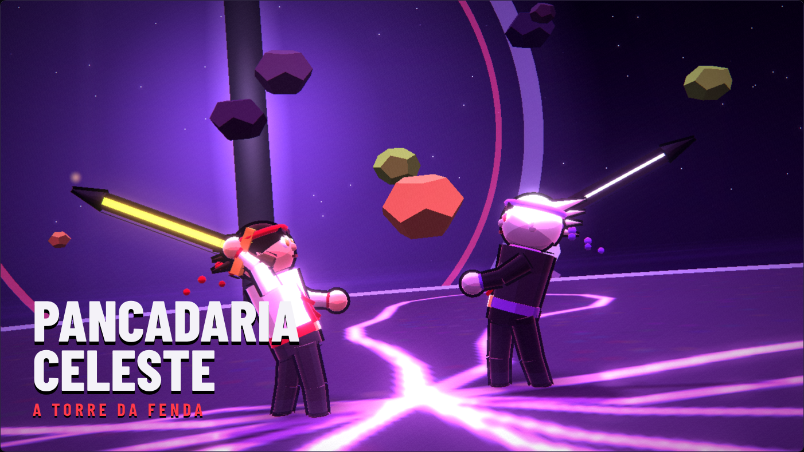

# Pancadaria Celeste: A Torre da Fenda

Ação em 3ª pessoa no estilo souls, feita num único `index.html` com Three.js. Você é **Gui**, herdeiro da Lâmina da Fenda, e sobe a Torre da Fenda enfrentando guerreiros de mundos costurados pelo céu partido.

## Como jogar

Abra `index.html` num navegador moderno (precisa de WebGL e internet para carregar o Three.js e as fontes). O progresso fica salvo no navegador.

| Ação | Teclado e mouse | Controle |
|---|---|---|
| Mover | WASD | analógico esquerdo |
| Câmera | mouse (clique na tela) ou setas | analógico direito |
| Travar mira | Q / Tab / botão do meio | R3 |
| Atacar | J / clique esquerdo | RB |
| Ataque forte | K / E | RT |
| Defender / aparar | L / clique direito | LB |
| Esquivar / correr | Shift | B |
| Pular (duplo no ar) | Espaço | A |
| Artes da Fenda | U, I | Y, LT |
| Despertar | O | L3 |
| Curar | F / R | X |
| Pausa | Esc | Start |

## Conteúdo

- Combate de postura: aparar (弾き), mikiri, choque de lâminas, contra-ataque, golpe fatal (斬)
- 19 andares em 3 atos com cutscenes 3D no estilo JoJo
- 24 missões dos aliados, Selos da Fenda e evolução do Gui (atributos, técnicas e forja da lâmina)
- Ascensão infinita, duelo livre e treino

## Estrutura

- `index.html`: o jogo inteiro
- `ARQUITETURA.md`: documentação técnica do motor e dos sistemas
- `testes/`: testes automatizados com Playwright (veja `testes/LEIA-ME.txt`)
- `versoes/`: a versão anterior (platform fighter 2.5D) e seus testes
